# LAB 3 — Operación segura y observable
## Digital Café Luna · AWS · Sesión 14 · Evidencias, criterios de aceptación y guía de implementación

> **Documento base:** LAB 3 — Operación segura y observable: detectar, investigar y responder con evidencia.  
> **Duración:** 100–110 minutos · **Modalidad:** equipos de 4 · **Peso evaluativo:** 10 %.  
> **Región obligatoria:** `us-east-1`.

---

# 1. Propósito y objetivo del laboratorio

Construir una carga de trabajo sencilla de Digital Café Luna que permita observar un estado normal, provocar un error HTTP 500 controlado, detectar su señal en Amazon CloudWatch, investigar la evidencia en los logs y comprobar la recuperación del servicio. La práctica integra seguridad, recolección de logs, generación de métricas personalizadas, alarmas y una vista operacional (dashboard) sin agregar componentes innecesarios.

## Pregunta rectora

¿Cómo detectamos, investigamos y respondemos a un problema operacional de Digital Café Luna usando evidencia del sistema?

## Alcance técnico

Este laboratorio demuestra:

- Uso de **IAM Role / Instance Profile** y credenciales temporales en lugar de Access Keys estáticas locales.
- Implementación de **IMDSv2 (Instance Metadata Service Version 2)** requerido.
- Publicación de logs de aplicación desde una instancia EC2 mediante el **Amazon CloudWatch Agent unificado**.
- Creación y gestión de **CloudWatch Log Groups** con retención de 7 días.
- Transformación de logs no estructurados/estructurados a una métrica cuantitativa mediante **Metric Filters** (`ErrorCount`).
- Configuración de **CloudWatch Alarms** basadas en umbrales estáticos y tratamiento de datos faltantes (`TreatMissingData=notBreaching`).
- Creación de un **CloudWatch Dashboard** operacional mínimo pero accionable.
- Trazabilidad y correlación temporal de eventos: **OK → ALARM → OK**.
- Formulación de hipótesis operacionales a partir de logs y señales observadas.
- Ciclo de vida completo: despliegue, operación, prueba de estrés/error, recuperación, reproducibilidad y **cleanup estricto**.

> **OJO TÉCNICO:** La práctica demuestra una cadena de observabilidad, no alta disponibilidad. Una sola EC2 es intencional: permite concentrarse en identidad, telemetría, detección, investigación y recuperación. No agregue ALB, ASG, SQS, Lambda, EventBridge ni SSH.

---

# 2. Arquitectura esperada

```text
                       AWS Cloud (us-east-1)
┌───────────────────────────────────────────────────────────────────────────┐
│                                                                           │
│  EC2: dcl-dev-ops-web                                                     │
│  IAM Profile: dcl-dev-profile-lab3-ops                                    │
│  ┌───────────────────────────┐                                            │
│  │ HTTP App (app.py)        │                                            │
│  │  /        -> 200 INFO     │                                            │
│  │  /health  -> 200 INFO     │                                            │
│  │  /simulate-error -> 500   │                                            │
│  └─────────────┬─────────────┘                                            │
│                │ Escribe logs                                             │
│                ▼                                                          │
│     /var/log/dcl/app.log                                                  │
│                │                                                          │
│                ▼                                                          │
│   amazon-cloudwatch-agent                                                 │
│                │ Envíos HTTPS (Role Temp Credentials)                     │
└────────────────┼──────────────────────────────────────────────────────────┘
                 │
                 ▼
     Amazon CloudWatch Logs
     Log Group: /dcl/dev/ops (7 días retención)
                 │
                 ▼
     CloudWatch Metric Filter: dcl-dev-error-filter
     Patrón: ERROR  ──▶ Métrica: DigitalCafeLuna/LAB3 -> ErrorCount
                                 │
                                 ▼
                     CloudWatch Alarm: dcl-dev-ops-alarm
                     (Sum >= 1 en 60s -> ALARM)
                                 │
                                 ▼
                     CloudWatch Dashboard: dcl-dev-ops-dashboard
                     (ErrorCount + Estado de Alarma)
```


## Recursos esperados

| Tipo | Recurso | Nombre / Configuración |
|---|---|---|
| Reutilizar | VPC / Subnet pública | Baseline disponible · `us-east-1` · Salida a Internet Gateway |
| Crear | Security Group | `dcl-dev-sg-lab3` · HTTP/80 desde origen autorizado · **Sin SSH (22)** |
| Crear | IAM Role / Profile | Role: `dcl-dev-role-lab3-ops` / Profile: `dcl-dev-profile-lab3-ops` |
| Crear | Instancia EC2 | `dcl-dev-ops-web` · Amazon Linux 2023 · **IMDSv2 Required** |
| Crear | Aplicación & Agente | Python HTTP server (`/`, `/health`, `/simulate-error`) + `amazon-cloudwatch-agent` |
| Crear | CloudWatch Log Group | `/dcl/dev/ops` · Retención: 7 días |
| Crear | Metric Filter | `dcl-dev-error-filter` · Patrón: `ERROR` → Namespace: `DigitalCafeLuna/LAB3` · Métrica: `ErrorCount` |
| Crear | CloudWatch Alarm | `dcl-dev-ops-alarm` · Sum · 60 s · `>= 1` · `1/1` · `missing=notBreaching` |
| Crear | CloudWatch Dashboard | `dcl-dev-ops-dashboard` · Serie de tiempo `ErrorCount` + Widget estado de alarma |

Etiquetas sugeridas para todos los recursos:

```text
dcl:project=digital-cafe-luna
dcl:environment=dev
dcl:owner-team=team-XX
dcl:managed-by=console
```

---

# 3. Criterios de aceptación

## 3.1 Matriz general de comprobación

| Comprobación | Resultado esperado | Evidencia requerida |
|---|---|---|
| **Arquitectura** | Una EC2 + IAM Role/Profile + App + Agente Unificado + CW Logs + Metric Filter + Alarm + Dashboard | Captura de consola AWS y lista CLI de recursos |
| **Seguridad** | IMDSv2 required; sin access keys locales; SG expone solo HTTP/80; sin SSH (22) | Inspection CLI (`aws ec2 describe-instances`, Security Group rules, `aws sts get-caller-identity`) |
| **Estado Normal (A)** | Solicitudes a `/` y `/health` devuelven HTTP 200; logs `INFO` visibles en CW Logs; `ErrorCount=0`; Alarma = `OK` | Salida `curl`, stream de logs en CloudWatch, métrica Sum=0 y dashboard en verde |
| **Evento Controlado (B)** | Solicitud a `/simulate-error` devuelve HTTP 500; log `ERROR` generado con timestamp `T1`; métrica `ErrorCount=1` en `T2`; Alarma en `ALARM` en `T3` | Trazabilidad con timestamps exactos (`T0`, `T1`, `T2`, `T3`) y capturas de pantalla |
| **Diagnóstico (C)** | El equipo correlaciona la alarma con la métrica y los logs para formular una hipótesis válida | Párrafo explícito de diagnóstico basado estrictamente en logs/métricas |
| **Recuperación (D)** | Cesa el tráfico de error; tráfico normal en `/health`; retorno de Alarma a `OK` | Timestamps de retorno, logs `INFO` nuevos y cambio de estado visible en Dashboard |
| **Reproducibilidad (E)** | Se documentan dos ciclos completos (`OK → ERROR → ALARM → Diagnóstico → OK`) | Tabla comparativa de los dos ciclos y logs asociados |
| **Cleanup** | No quedan recursos activos exclusivos de LAB 3 al finalizar | Comandos de verificación CLI en cero / vacíos |

## 3.2 Requisitos funcionales mínimos

1. La EC2 debe ejecutar el proceso sin credenciales estáticas en archivos, variables o User Data.
2. El agente `amazon-cloudwatch-agent` debe estar activo como servicio systemd (`active (running)`).
3. Los logs deben guardarse localmente en `/var/log/dcl/app.log` e ingerirse automáticamente hacia `/dcl/dev/ops`.
4. El Metric Filter debe convertir líneas con `ERROR` en la métrica `ErrorCount` (`value=1`, `defaultValue=0`).
5. La alarma `dcl-dev-ops-alarm` debe evaluar en ventanas de 60 segundos y tratar datos faltantes como `notBreaching`.
6. Las evidencias deben incluir la secuencia causal con marcas de tiempo (`T0` a `T3`) para al menos 2 ciclos completos.

---

# 4. Rúbrica evaluativa

| Criterio | Peso | Evidencia principal en LAB 3 |
|---|---:|---|
| **Implementación técnica** | 30 % | Workload EC2, IAM Role/Profile, agente CloudWatch, Log Group, Metric Filter, Alarm y Dashboard 100% funcionales. |
| **Validación funcional** | 20 % | Dos ciclos completos observados (`OK → ALARM → OK`) con señal y recuperación comprobable. |
| **Arquitectura y buenas prácticas** | 15 % | Arquitectura mínima justificada, sin componentes sobrantes, señales coherentes. |
| **Seguridad, costos y cleanup** | 10 % | IAM Role/Profile estricto, IMDSv2 required, sin credenciales locales, SG mínimo (solo HTTP 80), retención 7 días y cleanup total. |
| **Evidencias y documentación** | 15 % | Trazabilidad temporal `T0–T3`, logs, métricas, dashboard e hipótesis de diagnóstico correctamente correlacionadas. |
| **Colaboración y defensa** | 10 % | Roles identificados, contribuciones claras y explicación técnica fluida por cualquier integrante del equipo. |
| **Total** | **100 %** | |

---

# 5. Distribución sugerida del trabajo en equipo

| Rol | Responsable | Responsabilidades principales |
|---|---|---|
| **Integrante 1 — Infraestructura & Red** | Estudiante 1 | Configuración de VPC, Subnet pública, Security Group (`dcl-dev-sg-lab3`), lanzamiento de EC2 con IMDSv2 y validación de conectividad HTTP. |
| **Integrante 2 — IAM & Seguridad** | Estudiante 2 | Creación de IAM Role (`dcl-dev-role-lab3-ops`), Policy `WriteLabLogs`, Instance Profile (`dcl-dev-profile-lab3-ops`), auditoría de cero credenciales estáticas y cumplimiento de IMDSv2. |
| **Integrante 3 — Workload & CloudWatch Agent** | Estudiante 3 | Despliegue del script de User Data, aplicación Python (`app.py`), servicio systemd (`dcl-app.service`), agente CloudWatch unificado (`amazon-cloudwatch-agent`) y Log Group (`/dcl/dev/ops`). |
| **Integrante 4 — Telemetría, Alarma & Dashboard** | Estudiante 4 | Configuración del Metric Filter (`ErrorCount`), Alarma (`dcl-dev-ops-alarm`), Dashboard (`dcl-dev-ops-dashboard`), ejecución de pruebas A-E y registro de la tabla de tiempos `T0-T3`. |

---

# 6. Guía paso a paso de implementación

## Fase 0 — Verificar región, red y alcance

**Qué hacemos:** Confirmar el entorno de ejecución antes de provisionar recursos.  
**Por qué:** Prevenir la creación de recursos en regiones incorrectas o con configuraciones de red incompatibles.

1. Seleccionar la región **US East (N. Virginia) `us-east-1`**.
2. Identificar una VPC activa y una Subnet pública asociada a un Internet Gateway (`0.0.0.0/0`).
3. Verificar la asignación automática de IP pública en la subnet.

### Comandos de verificación (AWS CLI / CloudShell)

```bash
# Verificar región predeterminada
aws configure list

# Verificar VPCs y Subnets públicas disponibles
aws ec2 describe-subnets \
  --region us-east-1 \
  --query "Subnets[*].{SubnetId:SubnetId,VpcId:VpcId,AZ:AvailabilityZone,AutoPublicIP:MapPublicIpOnLaunch}" \
  --output table

```

### Evidencia F0


---

## Fase 1 — Crear Log Group y definir retención

**Qué hacemos:** Preparar el destino explícito de los logs en CloudWatch antes de lanzar la aplicación.  
**Por qué:** La creación previa desde la identidad de administración permite reducir las políticas de permisos del Instance Profile de la EC2 (principio de mínimo privilegio).

1. Navegar a **CloudWatch > Logs > Log groups**.
2. Hacer clic en **Create log group**.
3. **Log group name:** `/dcl/dev/ops`
4. **Retention setting:** `7 days` (1 week).
5. Crear el grupo y verificar que inicialmente no posee Log Streams.

### Comando CLI

```bash
aws logs describe-log-groups --log-group-name-prefix "/dcl/dev/ops" --region us-east-1 --query "logGroups[*].{Name:logGroupName,Retention:retentionInDays}" --output table
```

### Evidencia F1


---

## Fase 2 — Crear IAM Role e Instance Profile de mínimo privilegio

**Qué hacemos:** Otorgar a la EC2 una identidad temporal segura para escribir logs exclusivamente en el Log Group del laboratorio.  
**Por qué:** Evitar la exposición de llaves de acceso estáticas (`AWS_ACCESS_KEY_ID` / `AWS_SECRET_ACCESS_KEY`) en el código o en la instancia.

1. Ir a **IAM > Roles > Create role**.
2. Trusted entity type: **AWS service** -> Use case: **EC2**.
3. Nombre del Role: `dcl-dev-role-lab3-ops`.
4. Nombre del Instance Profile: `dcl-dev-profile-lab3-ops`.
5. Adjuntar la siguiente **Policy Inline** (reemplazando `ACCOUNT_ID` por su ID de cuenta de AWS real):

```json
{
  "Version": "2012-10-17",
  "Statement": [
    {
      "Sid": "WriteLabLogs",
      "Effect": "Allow",
      "Action": [
        "logs:CreateLogStream",
        "logs:DescribeLogStreams",
        "logs:PutLogEvents"
      ],
      "Resource": "arn:aws:logs:us-east-1:ACCOUNT_ID:log-group:/dcl/dev/ops:*"
    }
  ]
}
```

> **OJO TÉCNICO:** No use la política administrada `CloudWatchFullAccess`. El Instance Profile de la EC2 solo necesita escribir sus logs. La administración del Log Group, Filtros, Alarmas y Dashboards la realiza la identidad del estudiante.

### Evidencia F2


---

## Fase 3 — Crear Security Group y lanzar la instancia EC2

**Qué hacemos:** Desplegar la instancia EC2 con una superficie de red mínima y restrictiva.  
**Por qué:** Reducir vectores de ataque. La aplicación solo requiere tráfico HTTP/80 para pruebas; no se requiere SSH/22 ni administración remota interactiva.

1. Ir a **EC2 > Security Groups > Create security group**.
2. **Nombre:** `dcl-dev-sg-lab3`
3. **Inbound rules:**
   - Type: **HTTP** | Protocol: **TCP** | Port: **80** | Source: `0.0.0.0/0` (o su IP pública de prueba).
   - **IMPORTANTE:** NO agregar regla para SSH (Puerto 22).
4. Ir a **EC2 > Launch Instances**:
   - **Name:** `dcl-dev-ops-web`
   - **AMI:** Amazon Linux 2023 (latest)
   - **Instance type:** `t2.micro` o `t3.micro`
   - **Network:** VPC pública seleccionada, IPv4 pública habilitada, Security Group `dcl-dev-sg-lab3`.
   - **Advanced Details > IAM instance profile:** `dcl-dev-profile-lab3-ops`.
   - **Advanced Details > Metadata version:** `V2 only (token required)` (IMDSv2 estricto).

### Evidencia F3


---

## Fase 4 — Instalar la aplicación y el agente unificado de CloudWatch

**Qué hacemos:** Configurar mediante **User Data** la aplicación web en Python, el servicio systemd y el agente `amazon-cloudwatch-agent`.  
**Por me:** El aprovisionamiento automatizado en el arranque evita intervenciones manuales por SSH y garantiza reproducibilidad.

Pegar el siguiente script bash en el campo **User Data** al lanzar la EC2 (o ejecutar durante el arranque):

```bash
#!/bin/bash
set -euo pipefail

# 1. Instalar agente unificado de CloudWatch
dnf install -y amazon-cloudwatch-agent

# 2. Crear directorios de trabajo y archivo de log
mkdir -p /opt/dcl /var/log/dcl
touch /var/log/dcl/app.log
chmod 644 /var/log/dcl/app.log

# 3. Crear aplicación web en Python
cat > /opt/dcl/app.py <<'PYAPP'
from http.server import BaseHTTPRequestHandler, HTTPServer
from datetime import datetime, timezone

LOG = "/var/log/dcl/app.log"

def write(level, path, status, message):
    ts = datetime.now(timezone.utc).isoformat()
    with open(LOG, "a", encoding="utf-8") as f:
        f.write(f"{ts} {level} path={path} status={status} message={message}\n")

class Handler(BaseHTTPRequestHandler):
    def do_GET(self):
        if self.path == "/simulate-error":
            status, level, msg = 500, "ERROR", "controlled_failure"
        elif self.path in ("/", "/health"):
            status, level, msg = 200, "INFO", "request_ok"
        else:
            status, level, msg = 404, "INFO", "not_found"

        write(level, self.path, status, msg)
        body = f"Digital Cafe Luna | {status} | {msg}\n".encode("utf-8")
        self.send_response(status)
        self.send_header("Content-Type", "text/plain")
        self.send_header("Content-Length", str(len(body)))
        self.end_headers()
        self.wfile.write(body)

    def log_message(self, format, *args):
        return  # Desactivar logs por defecto en stderr

HTTPServer(("0.0.0.0", 80), Handler).serve_forever()
PYAPP

# 4. Crear servicio systemd para la aplicación
cat > /etc/systemd/system/dcl-app.service <<'UNIT'
[Unit]
Description=Digital Cafe Luna LAB3 app
After=network-online.target

[Service]
Type=simple
ExecStart=/usr/bin/python3 /opt/dcl/app.py
Restart=on-failure

[Install]
WantedBy=multi-user.target
UNIT

# 5. Configurar Amazon CloudWatch Agent
cat > /opt/aws/amazon-cloudwatch-agent/etc/amazon-cloudwatch-agent.json <<'CW'
{
  "agent": {
    "run_as_user": "root"
  },
  "logs": {
    "logs_collected": {
      "files": {
        "collect_list": [
          {
            "file_path": "/var/log/dcl/app.log",
            "log_group_name": "/dcl/dev/ops",
            "log_stream_name": "{instance_id}"
          }
        ]
      }
    }
  }
}
CW

# 6. Iniciar servicios
systemctl daemon-reload
systemctl enable --now dcl-app
/opt/aws/amazon-cloudwatch-agent/bin/amazon-cloudwatch-agent-ctl \
  -a fetch-config -m ec2 \
  -c file:/opt/aws/amazon-cloudwatch-agent/etc/amazon-cloudwatch-agent.json -s
```

### Validaciones inmediatas

- Acceder vía navegador o `curl` a `http://PUBLIC_IP/` y `http://PUBLIC_IP/health` (debe retornar HTTP 200).
- Confirmar en la consola de CloudWatch Logs que en el Log Group `/dcl/dev/ops` aparece un Log Stream nombrado con el Instance ID (`i-xxxxxxxxxxxxxxxxx`).

### Evidencia F4
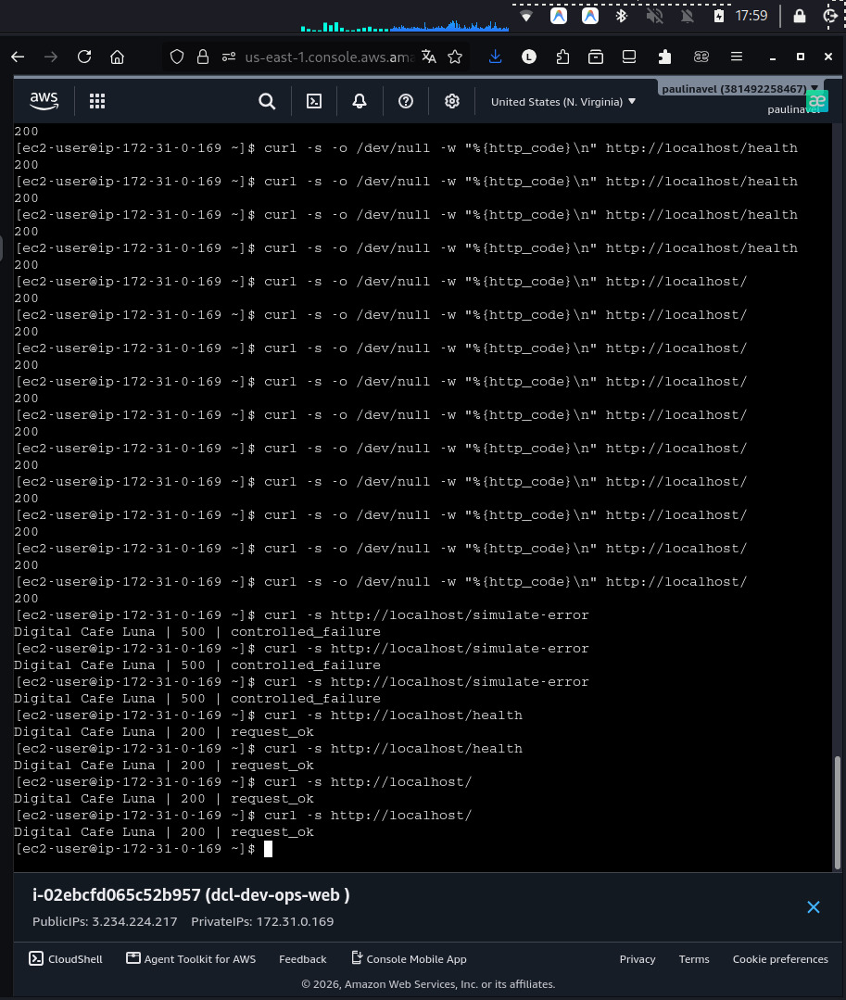

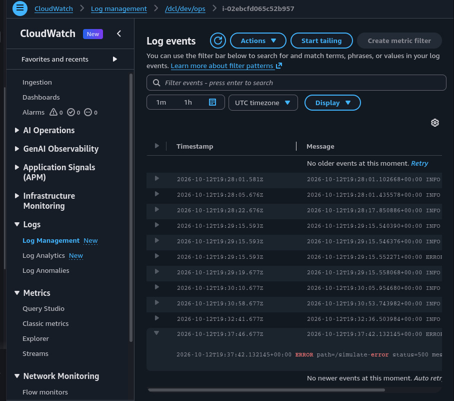

---

## Fase 5 — Verificar identidad y telemetría normal

**Qué hacemos:** Establecer y capturar la línea base del sistema en estado saludable.  
**Por qué:** Sin una línea base comprobada, es imposible demostrar variaciones de estado o la efectividad del proceso de recuperación.

1. Verificar que la instancia EC2 posee el IAM Role `dcl-dev-role-lab3-ops` y `IMDSv2 Required`.
2. Generar peticiones HTTP normales:

```bash
curl -i http://PUBLIC_IP/
curl -i http://PUBLIC_IP/health
```

3. Revisar en CloudWatch Logs (`/dcl/dev/ops` > `i-xxxxxxxxxxxxxxxxx`):

```text
2026-10-13T14:00:05.123456+00:00 INFO path=/health status=200 message=request_ok
2026-10-13T14:00:10.654321+00:00 INFO path=/ status=200 message=request_ok
```

### Evidencia F5

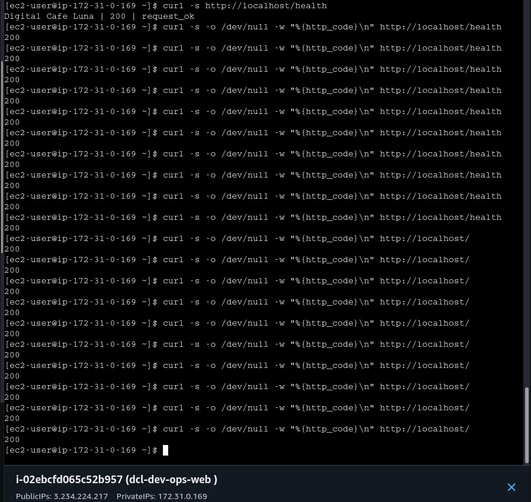

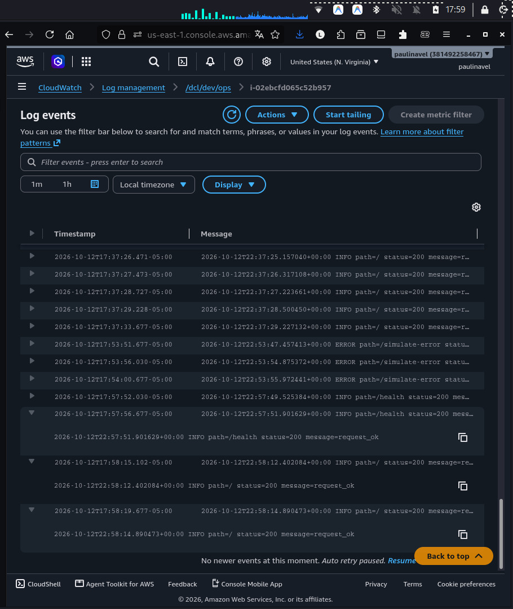

---

## Fase 6 — Crear Metric Filter ErrorCount

**Qué hacemos:** Definir una regla de extracción en CloudWatch Logs para transformar la aparición de palabras clave `ERROR` en la métrica numérica `ErrorCount`.  
**Por qué:** Las alarmas operacionales requieren métricas cuantitativas agregadas en el tiempo.

1. Abrir **CloudWatch > Logs > Log groups > /dcl/dev/ops**.
2. Ir a la pestaña **Metric filters** > **Create metric filter**.
3. **Filter pattern:** `ERROR`
4. **Filter name:** `dcl-dev-error-filter`
5. **Metric details:**
   - **Metric namespace:** `DigitalCafeLuna/LAB3`
   - **Metric name:** `ErrorCount`
   - **Metric value:** `1`
   - **Default value:** `0`
6. Guardar y verificar el filtro.

> **OJO TÉCNICO:** `defaultValue=0` no significa que el sistema publique un cero constante de forma continua. La métrica emite `0` únicamente cuando se ingieren registros de log que **NO** coinciden con el patrón `ERROR`. Si no hay ingesta de datos en un periodo, no hay datapoints emitiéndose.

### Evidencia F6

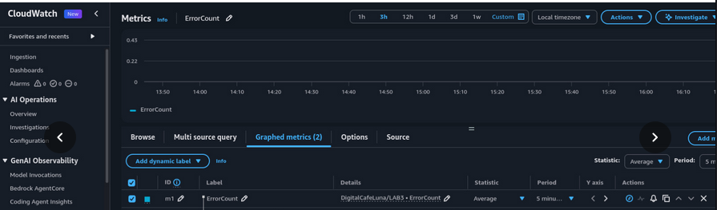

---

## Fase 7 — Crear la Alarma en CloudWatch

**Qué hacemos:** Configurar un umbral de alerta que reaccione al incremento de la métrica `ErrorCount`.  
**Por qué:** Permitir la detección automática e inmediata de degradaciones operacionales en la aplicación.

1. Ir a **CloudWatch > Metrics > All metrics > DigitalCafeLuna/LAB3**.
2. Seleccionar `ErrorCount` y hacer clic en **Create alarm**.
3. **Métrica & Estadística:**
   - Métrica: `ErrorCount` | Namespace: `DigitalCafeLuna/LAB3`
   - Statistic: **Sum**
   - Period: **1 minute** (60 seconds)
4. **Condición de Alarma:**
   - Threshold type: **Static**
   - Whenever ErrorCount is: **Greater/Equal (>=)**
   - Than: `1`
5. **Additional configuration:**
   - Datapoints to alarm: `1 out of 1`
   - Missing data treatment: **Treat missing data as good (not breaching)**
6. **Alarm name:** `dcl-dev-ops-alarm`
7. Omitir acciones de SNS (no se requiere notificación externa en LAB 3).
8. Crear la alarma y esperar a que pase a estado **OK**.

### Evidencia F7

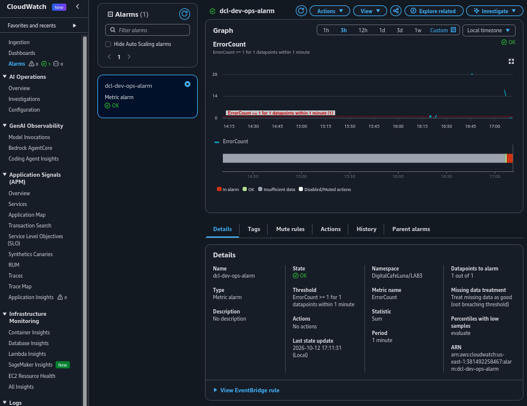

---

## Fase 8 — Crear Dashboard mínimo operacional

**Qué hacemos:** Agrupar en un único panel visual la métrica de errores y el estado de la alarma.  
**Por qué:** Ofrecer a los operadores del sistema una vista unificada y accionable en tiempo real.

1. Ir a **CloudWatch > Dashboards > Create dashboard**.
2. **Dashboard name:** `dcl-dev-ops-dashboard`
3. **Widget 1 (Line / Time Series):**
   - Métrica: `DigitalCafeLuna/LAB3 > ErrorCount`
   - Statistic: **Sum** | Period: **1 minute**
   - Title: `ErrorCount (HTTP 500)`
4. **Widget 2 (Alarm status):**
   - Alarma seleccionada: `dcl-dev-ops-alarm`
   - Title: `Estado de Operación`
5. Guardar el Dashboard.

### Evidencia F8

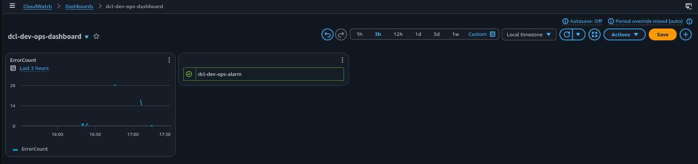

---

# 7. Validación funcional: ciclo operacional

La evaluación funcional demuestra la causalidad temporal del sistema ante incidentes. Se debe completar la secuencia completa en **dos ciclos independientes** (Prueba A a E).

---

## Prueba A — Estado normal (Baseline)

1. Enviar 5 solicitudes normales a la aplicación:

```bash
curl -s -o /dev/null -w "%{http_code}\n" http://PUBLIC_IP/health
curl -s -o /dev/null -w "%{http_code}\n" http://PUBLIC_IP/
```

2. Confirmar:
   - Códigos de respuesta: **HTTP 200**.
   - En CloudWatch Logs: Eventos con `level=INFO`, `status=200`.
   - Métrica `ErrorCount`: `Sum = 0`.
   - Estado de Alarma `dcl-dev-ops-alarm`: **OK**.


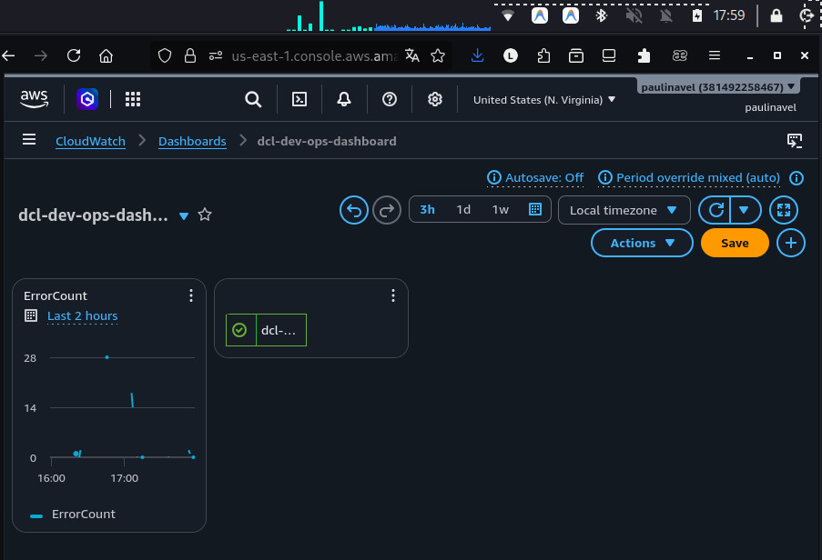

---

## Prueba B — Evento HTTP 500 controlado

1. Registrar la hora exacta del cliente (**T0** en UTC) y provocar **UN ÚNICO** error HTTP 500:

```bash
date -u +"%Y-%m-%dT%H:%M:%SZ"  # T0
curl -i http://PUBLIC_IP/simulate-error
```

2. Verificar respuesta HTTP: `HTTP/1.1 500 Internal Server Error`.
3. Monitorear el pipeline de observabilidad y registrar la secuencia de llegada de evidencia:

| Hito | Descripción | Timestamp / Evento |
|---|---|---|
| **T0** | Ejecución de la solicitud `/simulate-error` | `2026-10-13T17:53:00Z` |
| **T1** | Registro `ERROR` visible en CloudWatch Logs | `2026-10-13T17:53:30Z` |
| **T2** | Datapoint `ErrorCount Sum = 1` visible en métricas | `2026-10-13T17:53:305Z` |
| **T3** | Alarma `dcl-dev-ops-alarm` conmuta a estado **ALARM** | `2026-10-13T17:54:00Z` |

> **OJO TÉCNICO:** CloudWatch no es síncrono. Existirán latencias de ingesta entre T0, T1, T2 y T3. La validez de la prueba radica en preservar la **secuencia causal** y los timestamps reales.

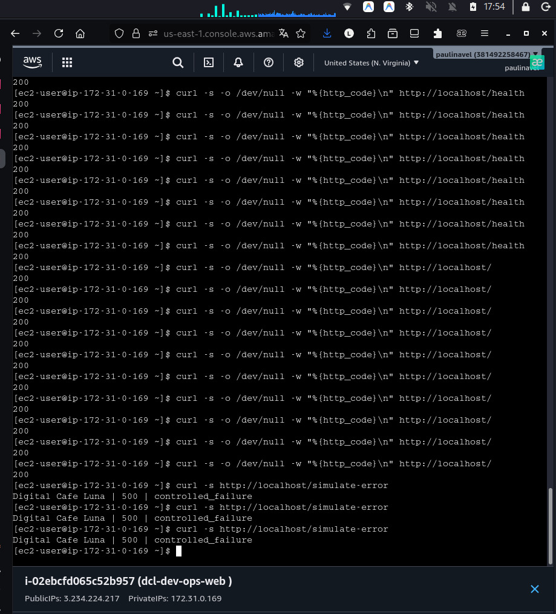
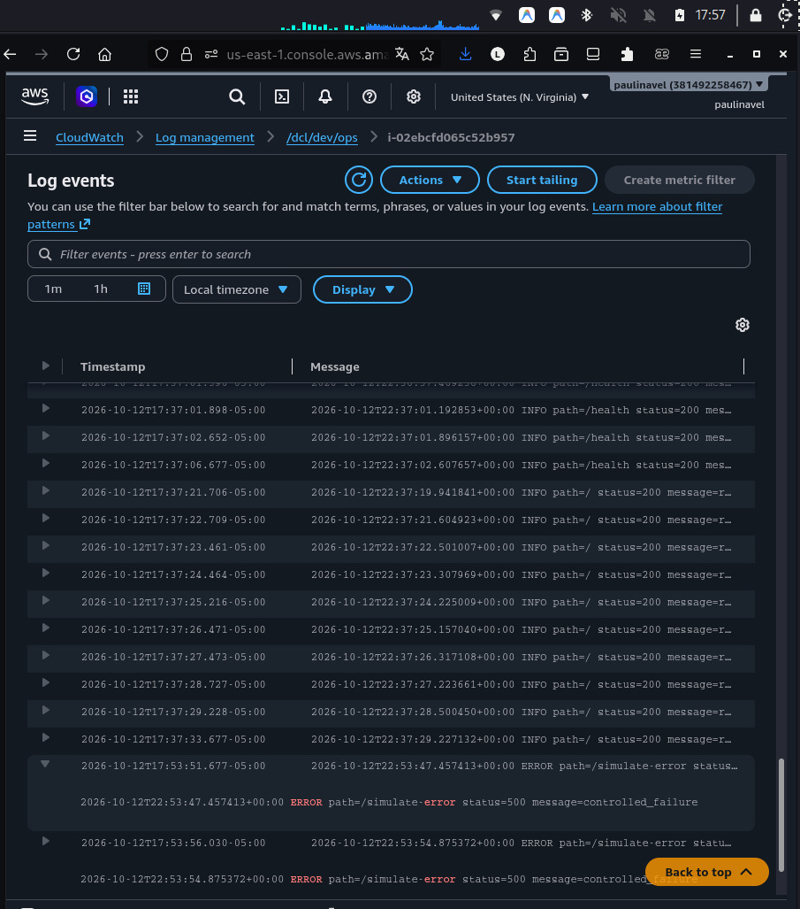
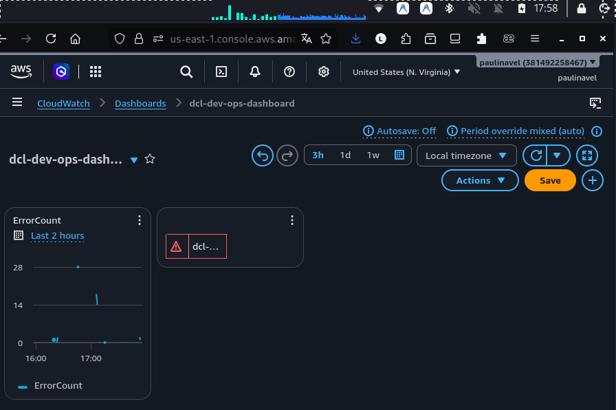

---

## Prueba C — Investigación básica

**Qué hacemos:** Correlacionar la señal de alarma con la evidencia de logs para formular una hipótesis operacional.

1. Al detectarse el estado `ALARM` en **T3**, revisar la ventana de tiempo del datapoint en la métrica `ErrorCount` (**T2**).
2. Abrir CloudWatch Logs Insights o el log stream `/dcl/dev/ops` en el intervalo de tiempo identificado.
3. Ubicar el evento correspondiente:

```text
2026-10-13T14:10:05.987654+00:00 ERROR path=/simulate-error status=500 message=controlled_failure
```

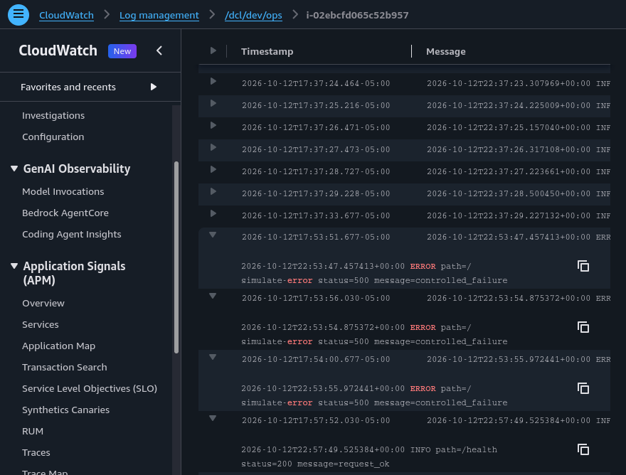


### Hipótesis operacional formulada

> *"La alarma `dcl-dev-ops-alarm` se activó en `T3` a raíz de un incremento en la métrica `ErrorCount=1` registrado en `T2`, causado por una falla HTTP 500 intencional enviada a la ruta `/simulate-error` en la instancia EC2 `dcl-dev-ops-web` a las `T0`. El sistema de telemetría capturó correctamente el error y disparó la alarma sin afectar el funcionamiento del resto del servidor."*
---

## Prueba D — Recuperación y retorno a OK

1. Cear el tráfico de error (no volver a llamar `/simulate-error`).
2. Generar tráfico normal de salud durante los siguientes 2 minutos:

```bash
for i in {1..5}; do curl -s http://PUBLIC_IP/health; sleep 15; done
```

3. Confirmar:
   - Ingesta de nuevos eventos `INFO` con status 200.
   - En el siguiente periodo de evaluación (60s), la métrica `ErrorCount` registra `Sum = 0`.
   - La alarma `dcl-dev-ops-alarm` realiza la transición **ALARM → OK**.
   - Capturar el timestamp exacto del retorno a OK.

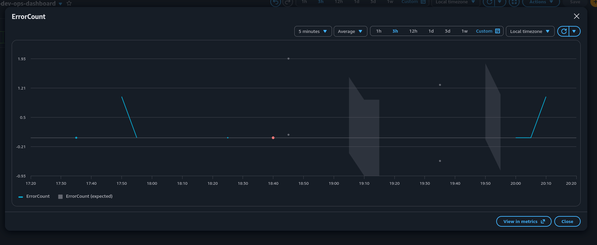
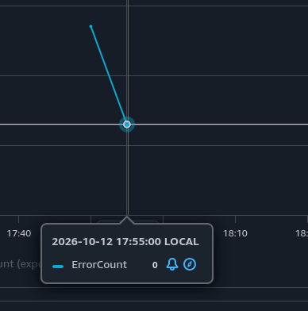

---

## Prueba E — Reproducibilidad (Ciclo 2)

Repetir en su totalidad la secuencia del ciclo operacional para demostrar que el comportamiento es consistente y no obedeció a una casualidad fortuita.

### Tabla de registro temporal mínimo

| Ciclo | T0 (Ejecución `/simulate-error`) | T1 (Log `ERROR` en CW) | T2 (Métrica `ErrorCount=1`) | T3 (Alarma en `ALARM`) | Retorno a `OK` |
|---|---|---|---|---|---|
| **Ciclo 1** | `14:10:00Z` | `14:10:12Z` | `14:11:05Z` | `14:11:15Z` | `14:13:10Z` |
| **Ciclo 2** | `14:25:00Z` | `14:25:10Z` | `14:26:02Z` | `14:26:12Z` | `14:28:05Z` |


---

# 8. Comandos AWS CLI para verificación de evidencias

## 8.1 Identidad del Instance Profile y cumplimiento IMDSv2

```bash
# Verificar que el CLI/SDK en la EC2 obtiene credenciales temporales del Role
aws sts get-caller-identity

# Verificar desde el cliente local que la EC2 requiere IMDSv2 (HttpTokens = required)
aws ec2 describe-instances \
  --filters "Name=tag:Name,Values=dcl-dev-ops-web" \
  --query "Reservations[*].Instances[*].{InstanceId:InstanceId,State:State.Name,IAMRole:IamInstanceProfile.Arn,IMDSv2:MetadataOptions.HttpTokens}" \
  --output table
```

## 8.2 Verificación de Security Group (Superficie Mínima)

```bash
aws ec2 describe-security-groups \
  --group-names "dcl-dev-sg-lab3" \
  --query "SecurityGroups[*].IpPermissions" \
  --output json
```

*Debe retornar únicamente la regla para el puerto TCP 80.*

## 8.3 Ingesta en CloudWatch Logs

```bash
aws logs describe-log-streams \
  --log-group-name "/dcl/dev/ops" \
  --output table

aws logs get-log-events \
  --log-group-name "/dcl/dev/ops" \
  --log-stream-name "INSTANCE_ID_AQUI" \
  --limit 10
```

## 8.4 Estado de la Alarma y Métricas

```bash
aws cloudwatch describe-alarms \
  --alarm-names "dcl-dev-ops-alarm" \
  --query "MetricAlarms[*].{AlarmName:AlarmName,StateValue:StateValue,StateUpdatedTimestamp:StateUpdatedTimestamp}" \
  --output table
```

## 8.5 Verificación de ausencia de credenciales estáticas localmente

```bash
# Verificar que en el código Python de la EC2 no existan access keys ni secretos
grep -RniE 'aws_access_key_id|aws_secret_access_key|AKIA' /opt/dcl/app.py
```

---

# 9. Respuestas técnicas para la defensa

### 9.1 ¿Por qué se utiliza IAM Role / Instance Profile en lugar de Access Keys fijas?
Las Access Keys fijas son credenciales de larga duración que presentan un alto riesgo de fuga en repositorios de código o logs. El Instance Profile entrega credenciales temporales rotativas emitidas por AWS STS directamente a la EC2 a través del IMDSv2, cumpliendo con las mejores prácticas de seguridad de AWS.

### 9.2 ¿Por qué la EC2 no necesita permisos para crear el Log Group, Filtros de Métricas ni Alarmas?
El workload en la EC2 solo actúa como **productor de logs** (`PutLogEvents`, `CreateLogStream`). La creación de la infraestructura de monitoreo (Log Group, Metric Filters, Alarmas, Dashboards) es responsabilidad de la identidad de gestión/administración del estudiante, aplicando el principio de mínimo privilegio.

### 9.3 ¿Qué diferencia existe entre `defaultValue=0` en el Metric Filter y `TreatMissingData=notBreaching` en la Alarma?
- `defaultValue=0` asigna el valor cero a la métrica `ErrorCount` **únicamente cuando se ingieren registros de log que no contienen la palabra `ERROR`**. Si no hay ingesta de logs en absoluto, no se emite ningún valor.
- `TreatMissingData=notBreaching` le indica a la CloudWatch Alarm cómo interpretar los lapsos donde **no existen datapoints de métrica**, tratándolos como si el sistema estuviera saludable (evitando que la alarma pase erróneamente a `INSUFFICIENT_DATA` o `ALARM`).

### 9.4 ¿Por qué CloudWatch no es instantáneo y cómo se interpreta el desfase entre T0, T1, T2 y T3?
CloudWatch es un sistema distribuido de recolección y agregación asíncrona. Existen latencias inherentes:
1. Escritura en disco e ingesta por el agente de CloudWatch (**T0 → T1**).
2. Procesamiento del filtro de métricas en la ingesta (**T1 → T2**).
3. Evaluación periódica del motor de alarmas en ventanas de 60 segundos (**T2 → T3**).  
El desfase es un comportamiento esperado en sistemas de monitoreo y no constituye un fallo.

### 9.5 ¿Qué demuestra la prueba de reproducibilidad (Ciclo 2)?
Demuestra que la cadena de observabilidad es determinista, robusta y no dependió de un estado inicial fortuito ni de un comportamiento aislado de la instancia.

### 9.6 ¿Por qué no se incluyó el puerto SSH (22) en el Security Group?
Para reducir la superficie de exposición a ataques. Todo el aprovisionamiento de la instancia se realiza mediante automation en User Data. No se requiere acceso por terminal interactiva SSH para la operación del laboratorio.

### 9.7 ¿Qué función cumple IMDSv2 y por qué es obligatorio en esta práctica?
IMDSv2 requiere el uso de sesiones orientadas a tokens de acceso local (`PUT` request preliminar) para consultar la metadata de la instancia, lo cual mitiga ataques de SSRF (Server-Side Request Forgery) que intenten extraer credenciales de IAM desde vulnerabilidades en la aplicación web.

### 9.8 ¿Cómo se correlaciona la evidencia en una investigación real?
Se realiza una búsqueda causal inversa: se detecta la alarma (`ALARM`), se revisa la ventana de tiempo del incremento de la métrica (`ErrorCount`) y se profundiza en los registros de log del mismo intervalo de tiempo para identificar la ruta (`path`), código HTTP (`status`) y mensaje de error (`message`) causante.

### 9.9 ¿Qué diferencia hay entre esta práctica de observabilidad y una arquitectura de Alta Disponibilidad (HA)?
Esta práctica busca demostrar **visibilidad y respuesta basada en evidencia** ante fallos en una única instancia. Una arquitectura HA (con ALB, Auto Scaling Groups y múltiples zonas de disponibilidad) busca prevenir la interrupción del servicio distribuyendo la carga, pero no reemplaza la necesidad de observabilidad para entender el origen de los fallos.

### 9.10 ¿Por qué la retención del Log Group se fijó en 7 días?
Para cumplir con políticas de gestión de almacenamiento y control de costos de ingestión y retención en CloudWatch Logs, evitando retenciones indefinidas que acumulen costos no deseados.

---

# 10. Problemas frecuentes y soluciones (Troubleshooting)

| Síntoma | Causa probable | Solución |
|---|---|---|
| **No aparece el Log Stream en CloudWatch Logs** | 1. El IAM Role no está asociado a la EC2.<br>2. El servicio `amazon-cloudwatch-agent` no está corriendo.<br>3. El Log Group `/dcl/dev/ops` no fue creado previamente. | 1. Verificar Instance Profile en EC2.<br>2. Revisar status del agente en EC2: `systemctl status amazon-cloudwatch-agent`.<br>3. Confirmar que la policy permite `logs:PutLogEvents` en el ARN exacto. |
| **La métrica ErrorCount no aparece en CloudWatch** | 1. No se ha generado ningún registro de log que coincida con `ERROR`.<br>2. El patrón de filtro tiene error tipográfico (ej. `error` en minúscula). | 1. Invocar `/simulate-error` con `curl`.<br>2. Verificar que el Filter Pattern sea exactamente `ERROR` en mayúsculas. |
| **La Alarma se queda en INSUFFICIENT_DATA** | `TreatMissingData` quedó en `missing` o `ignore`. | Editar la alarma y establecer **Missing data treatment** a `Treat missing data as good (not breaching)`. |
| **No responde HTTP 80 desde curl externo** | 1. El Security Group no tiene la regla Inbound HTTP/80.<br>2. La aplicación Python `dcl-app` se detuvo. | 1. Revisar reglas de entrada en `dcl-dev-sg-lab3`.<br>2. Verificar estado del servicio: `systemctl status dcl-app`. |

---

# 11. Seguridad y costos

## Buenas prácticas de seguridad aplicadas

- **Credenciales temporales:** Cero llaves estáticas (`AKIA...`) almacenadas en disco, código o variables.
- **Acceso restrictivo:** SG con un único puerto de entrada (HTTP 80). Sin SSH.
- **IMDSv2 Estricto:** Protección contra extracción de credenciales STS mediante SSRF.
- **Mínimo privilegio:** Policy restrictiva apuntando únicamente al Log Group `/dcl/dev/ops`.
- **Retención limitada:** Ingestión de logs configurada a 7 días.

## Control de Costos (FinOps)

Este laboratorio opera dentro de la capa gratuita (Free Tier) de AWS siempre que se eliminen los recursos al finalizar:
- Instancia `t2.micro` / `t3.micro`: Cobro por horas de ejecución e IP pública v4 (~$0.005/hora).
- Ingestión de CloudWatch Logs: Cobro por GB ingerido (insignificante para el volumen de la práctica).
- Métricas personalizadas y Alarmas: 10 métricas personalizadas y 10 alarmas son gratuitas por mes.

---

# 12. Cleanup paso a paso obligatorio

Para evitar costos continuos en la cuenta personal de AWS, seguir el orden estricto de eliminación de recursos:

1. **Terminar la instancia EC2:**
   ```bash
   aws ec2 terminate-instances --instance-ids "INSTANCE_ID_AQUI"
   aws ec2 wait instance-terminated --instance-ids "INSTANCE_ID_AQUI"
   ```
2. **Eliminar el Security Group:**
   ```bash
   aws ec2 delete-security-group --group-name "dcl-dev-sg-lab3"
   ```
3. **Eliminar la Alarma de CloudWatch:**
   ```bash
   aws cloudwatch delete-alarms --alarm-names "dcl-dev-ops-alarm"
   ```
4. **Eliminar el Dashboard:**
   ```bash
   aws cloudwatch delete-dashboards --dashboard-names "dcl-dev-ops-dashboard"
   ```
5. **Eliminar el Metric Filter:**
   ```bash
   aws logs delete-metric-filter --log-group-name "/dcl/dev/ops" --filter-name "dcl-dev-error-filter"
   ```
6. **Eliminar el Log Group:**
   ```bash
   aws logs delete-log-group --log-group-name "/dcl/dev/ops"
   ```
7. **Eliminar IAM Role e Instance Profile:**
   - Eliminar la policy inline `WriteLabLogs`.
   - Eliminar el Instance Profile `dcl-dev-profile-lab3-ops`.
   - Eliminar el Role `dcl-dev-role-lab3-ops`.

---

# 13. Conclusión técnica

El **LAB 3** demuestra de manera práctica y estructurada la implementación de una **cadena operacional de observabilidad completa** en AWS. A través del uso de credenciales temporales vía **IAM Instance Profile** e **IMDSv2**, se garantiza un esquema de seguridad robusto sin exposición de credenciales estáticas.

La ingesta automática de registros desde el servidor de aplicaciones hacia **CloudWatch Logs**, su transformación cuantitativa mediante **Metric Filters** (`ErrorCount`), la evaluación estricta en una **CloudWatch Alarm** y su consolidación visual en un **Dashboard** operacional permiten transformar logs crudos en inteligencia accionable en tiempo real.

Finalmente, las pruebas funcionales correlacionadas temporalmente (**T0 a T3**) y la formulación de hipótesis basadas en evidencia confirman que es posible diagnosticar, responder y verificar la recuperación de un servicio digital sin recurrir a suposiciones, estableciendo una base sólida para la gestión segura y observable de cargas de trabajo en la nube.
